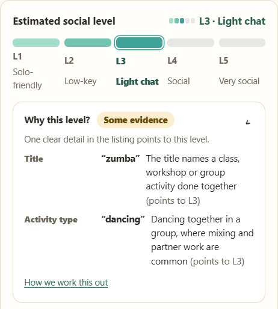
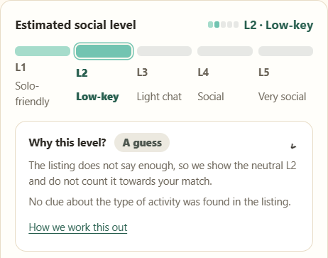

# Out & About Brisbane — Section 4.3 Supporting Evidence

**DECO1800 Design Computing Studio 1: Interactive Technology**  
Team JETZ · Report contribution: Tingyan Liu  
Evidence compiled: 29 October 2026

This page supports the report's account of a technical problem: estimating an activity's social interaction requirements from Council listings. It brings together implementation excerpts, a controlled regression comparison, test results and interface screenshots.

## Problem and solution

The earlier V13 estimator combined listing fields into one text string and returned the first keyword match. A dance class description containing **“at your own pace”** could therefore produce L1 (independent participation), even when the title and activity category supported guided group participation.

The later model assesses library type, activity type, title, broad category and description separately. It gives structured categories and titles more influence than description text, sums evidence for each level, and displays the reasons and strength of the estimate. Weak or conflicting evidence receives a provisional L2 and is marked as uncertain.

| Material | Evidence provided |
|---|---|
| [Earlier source excerpt](source-before.txt) | Fixed-order first-match classification in V13. |
| [Weighted-model source excerpt](source-after.txt) | Field weights, rule examples, scoring and uncertainty logic. |
| [Controlled regression cases](controlled-cases.json) | Same Zumba title/category, with only the description changed. |
| [Test results](test-results.txt) | Local rerun: 15 tests passed, 0 failed, covering the model and validation-statistics helpers. |
| [References](REFERENCES.md) | The two Council dataset sources and project-evidence attribution. |
| [Version and capture notes](PROVENANCE.md) | Which versions were inspected and what the evidence does and does not establish. |

## Controlled before-and-after comparison

These are **synthetic regression inputs**, not participant responses or complete Council records. Both use the title `Zumba Gold®` and activity type `Dancing`.

| Description | V13 result | Weighted-model result |
|---|---|---|
| Work at your own pace in a friendly class. | L1 | L3 |
| A fun low-impact class. | L3 | L3 |

This reproduces the specific inconsistency and verifies the corresponding technical fix. It does not measure classification accuracy across real activity sessions.

## Figure 1 — Explaining a social-level estimate

**Caption.** Local rendering of the supplied release's Zumba Gold® activity explanation, using an actual Council record from the bundled 14 October 2026 snapshot. The interface identifies L3, labels the evidence strength, and shows the matched title and category clues. Captured on 29 October 2026. This is a release-package screenshot, not a capture of the live Team Zone website or proof of the latest GitHub interface layout.

## Figure 2 — Communicating uncertainty

**Caption.** Local rendering of the supplied release's explanation for a Bellbowrie mobile library listing from the same snapshot. The interface explicitly labels the provisional L2 result as “A guess” because no activity-format clue was found. L2 is a fallback, not confirmation that the actual session requires little interaction.

## Verification limits

- The source release contains a 58-activity rating sheet with no completed rating cells; its historical audit states that human validation had not yet run. No attendee-validated accuracy claim is made here.
- The 15 passing checks are automated technical tests, not 15 participants or 15 observed activity sessions.
- The screenshots use the packaged data in a local offline preview. Live Council updates, the PHP account backend and Team Zone deployment were not tested during this capture.
- GitHub main inspected at `eab476f393123480baed57cbe402c3fcd042b066` contains later matching changes: unknown evidence is excluded from the internal preference-score denominator. The older release's denominator behavior must not be described as current main behavior. The five-level estimator itself retains the weighted v2 approach.

For the associated report wording, see [Section 4.3](REPORT-SECTION-4.3.md). Essential analysis should remain in the report; this repository supplies supporting evidence.
